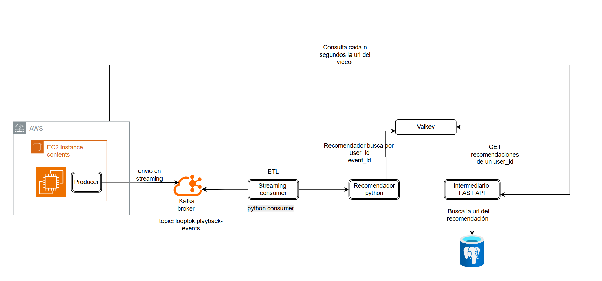

# React + TypeScript + Vite

# Qué hace el proyecto
LoopTok es una app de videos cortos. El frontend captura eventos de reproducción (inicio, progreso, final, abandono) y los envía al backend. El backend los valida y los publica en Kafka mediante un producer. Un consumer lee esos eventos del topic y, más adelante, los entregará a un recomendador (en desarrollo) que usará esa información para sugerir videos.



# Carpetas
```bash
loopTok/
├── frontend/                  # app React: feed, login y captura de eventos
├── backend/                   # API FastAPI + PostgreSQL
│   ├── app/                   # código de la API
│   ├── migrations/            # migraciones de la base de datos
│   ├── scripts/               
│   ├── tests/                 # tests del backend
│   └── compose.yaml           # Docker: PostgreSQL, Kafka y consumer
├── services/
│   └── playback-consumer/     # consumer de Kafka: lee y valida los eventos
└── recommender/               # recomendador
```

# Running
Requisitos: Docker, Node.js y Python 3.12. Antes de empezar, copia `backend/.env.example` a `backend/.env`.

## 1. Infraestructura (desde `backend/`)
Levanta PostgreSQL, Kafka, la creación del topic y el consumer:
```cmd
docker compose up -d --build
```
Para ver los eventos que recibe el consumer: `docker compose logs -f playback-consumer`

## 2. Backend (desde `backend/`)
```cmd
# activar el entorno virtual
.venv\Scripts\activate        # Windows
source .venv/bin/activate     # Linux / Mac

pip install -r requirements.txt
alembic upgrade head          # corre las migraciones
uvicorn app.main:app --reload
```

## 3. Frontend (desde `frontend/`)
```cmd
npm install
npm run dev
```

# Base de datos
## Añadir una nueva migración (desde `backend/`)
```cmd
# crea el archivo con los cambios en migrations/versions/
alembic revision --autogenerate -m "descripción de lo que cambió"
alembic upgrade head
```

## Conectarse a la base de datos
```cmd
docker exec -it backend-postgres-1 psql -U looptok -d looptok
```
Para listar las tablas, `\dt`, y para salir, `\q`.
